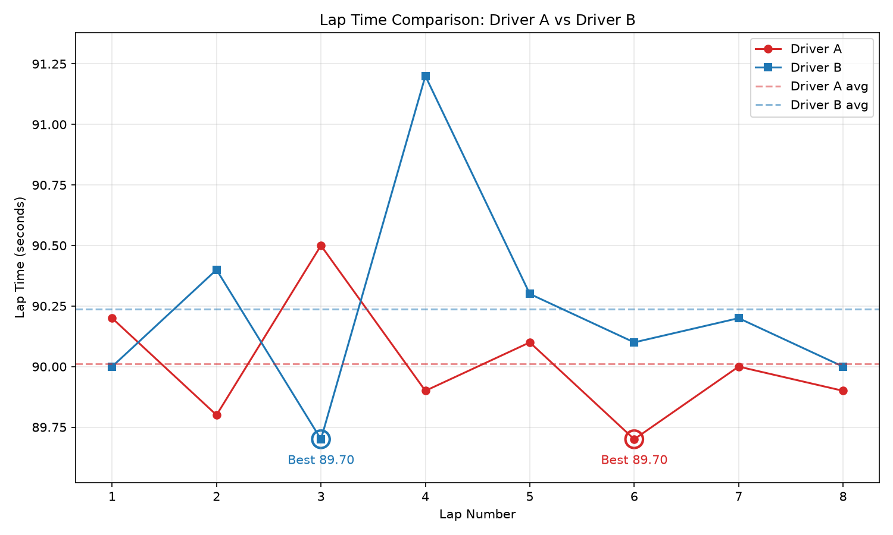

# F1 Lap Time Analyzer

A Python command-line tool that compares the lap times of two drivers and visualizes the results.



## Features
- Fastest lap for each driver (and which lap it happened on)
- Average lap time and the difference between drivers
- Lap-by-lap winner and gap
- Consistency analysis using standard deviation
- Detection of unusually slow laps
- Lap-time graph with average lines and fastest-lap markers (saved as PNG)
- Input from sample data, a CSV file, or manual entry, with input validation

## Tech stack
- Python 3.9+
- Matplotlib
- Standard library: `statistics`, `csv`, `argparse`

## Installation
```bash
git clone https://github.com/<your-username>/F1-Lap-Time-Analyzer.git
cd F1-Lap-Time-Analyzer
python -m venv venv
# Windows: venv\Scripts\activate    |    macOS/Linux: source venv/bin/activate
pip install -r requirements.txt
```

## Usage
```bash
python main.py                      # interactive menu
python main.py --csv lap_times.csv  # analyze a CSV file
python main.py --sample             # built-in sample data
python main.py --csv lap_times.csv --no-show   # save graph without opening a window
```

### CSV format
```
lap,Driver A,Driver B
1,90.2,90.0
2,89.8,90.4
```
The header names after `lap` are used as the driver names. Lap times are in seconds.

## Sample output
See [`sample_output.txt`](sample_output.txt).

## How consistency is measured
Consistency is the **population standard deviation** (`statistics.pstdev`) of a driver's lap times. A lower value means lap times vary less, so the driver is more consistent.

## Known limitations
- Compares exactly two drivers
- Both drivers must have the same number of laps
- Lap times must be in seconds (e.g. `90.25`, not `1:30.25`)
- Ignores tyre wear, fuel load and traffic

## Future improvements
- Support more than two drivers
- Accept `m:ss.SSS` lap-time format
- Streamlit dashboard
- Real race data (e.g. FastF1)
- Tyre degradation and sector-time analysis
